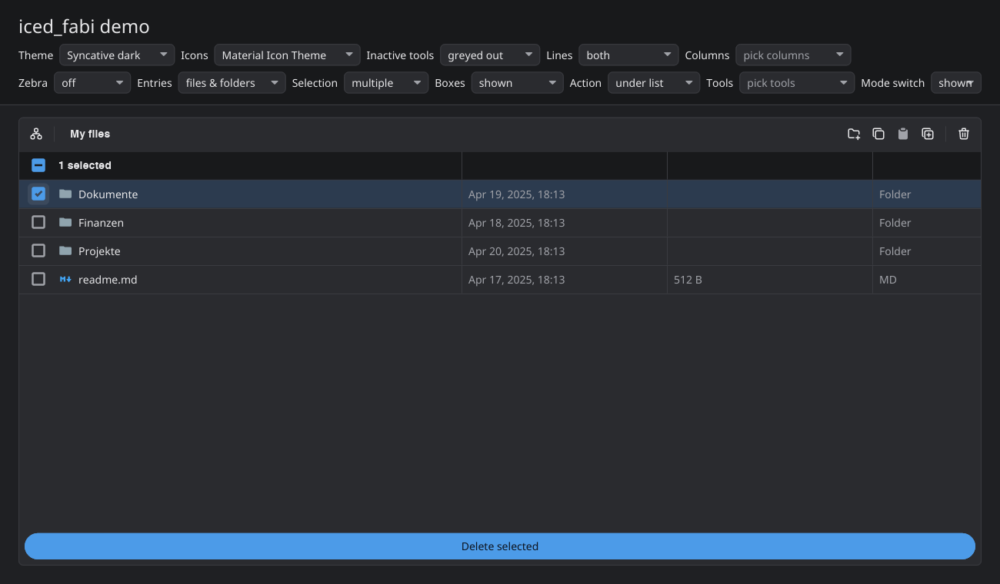

# iced_fabi

iced File cABInet: a widget for [iced](https://github.com/iced-rs/iced) for browsing directories and sorting or selecting items.



- **Two views over one state:** browse (one folder per screen with a breadcrumb bar, like Android's Files app) and tree (every branch expandable in place, selection across levels).
- **Selection:** a box on every row with a tick for a selected item and a minus while only part of a folder's content is selected; select-all in the header; many, one or no entries; boxes always shown, after a long press or hidden.
- **Listings come from the app:** the widget says which folder it needs, the app answers from disk, rclone or an HTTP API, and late answers for a closed folder are dropped.
- **Columns:** name, modified, size and your own (the screenshot adds a kind column); sortable, and fitted to narrow screens by leaving out the rightmost ones.
- **Look:** toolbar tools, one action button, zebra stripes, grid lines, and your theme's colours, font, text size, scrollbar and icon pack.
- **Pickers:** one folder, several folders or any entries in a modal, with saved paths ticked before their folders are listed.

## Usage

```toml
[dependencies]
iced_fabi = "0.1"
# or with the Material Icon Theme's file and folder glyphs:
iced_fabi = { version = "0.1", features = ["material-icon-theme"] }
```

```rust
use iced_fabi::{Browser, Event, Outcome};

// Set-up: the state lives in your app; `open` asks for the first listing.
let mut browser = Browser::new("My files");
let outcome = browser.open(); // Outcome::NeedsLoad(NodeId::ROOT)

// update(): hand every event to the browser and act on what it returns.
match browser.update(event) {
    Outcome::NeedsLoad(id) => { /* list browser.path_below_root(id), then browser.set_children(id, entries) */ }
    Outcome::FileOpened(id) => { /* open it */ }
    _ => {}
}

// view(): a builder, rebuilt every frame.
iced_fabi::cabinet(&browser, Message::Cabinet)
    .style(|theme| iced_fabi::Style::from_theme(theme))
    .into()
```

As a picker in a modal:

```rust
use iced_fabi::{ActionButton, ActionPlacement, Browser, Pick};

let mut picker = Browser::picker("My drive", Pick::Folders);
picker.select_paths(&saved_paths);

iced_fabi::cabinet(&picker, Message::Picker)
    .action(ActionButton::new("Save", Message::Confirm).placement(ActionPlacement::Footer))
    .cancel(Message::Cancel)
    .height(440)

// On Message::Confirm, picker.picked() holds the chosen paths below the root.
```

The [API documentation](https://docs.rs/iced_fabi) lists every setting.

It builds on `iced_widget` 0.14 only. An app on an iced fork patches `iced_widget` with the fork's, so Cargo builds one copy of iced:

```toml
[patch.crates-io]
iced_widget = { git = "https://github.com/your/iced", tag = "your-tag" }
```

## Examples

```sh
cargo run --example minimal                                       # the local disk through std::fs, in about 100 lines
cargo run --example cloud_browse --features material-icon-theme   # a fake cloud drive with every setting switchable
cargo run --example picker                                        # a settings form filled through three pickers
```

## License

MIT, see [LICENSE](LICENSE). Icons: [Tabler Icons](https://tabler.io/icons) and [Boxicons](https://boxicons.com) through [`icondata`](https://crates.io/crates/icondata), and with the `material-icon-theme` feature a cut of the [Material Icon Theme](https://github.com/material-extensions/vscode-material-icon-theme), all MIT; details in [NOTICE](NOTICE).
